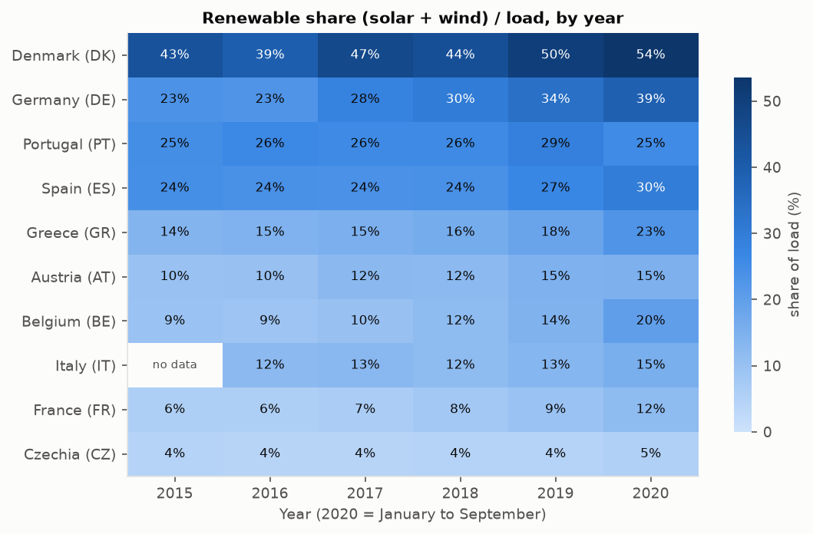
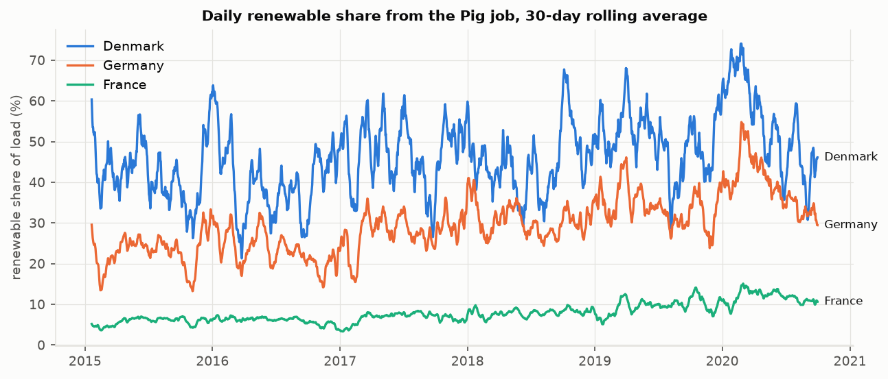
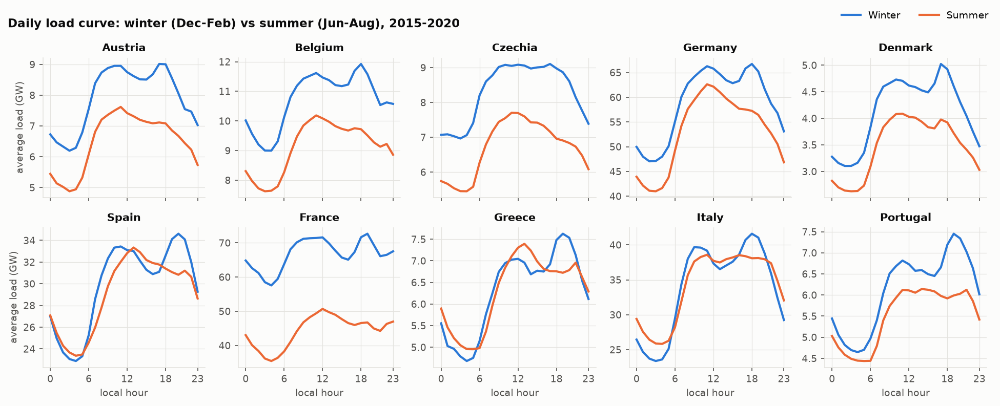
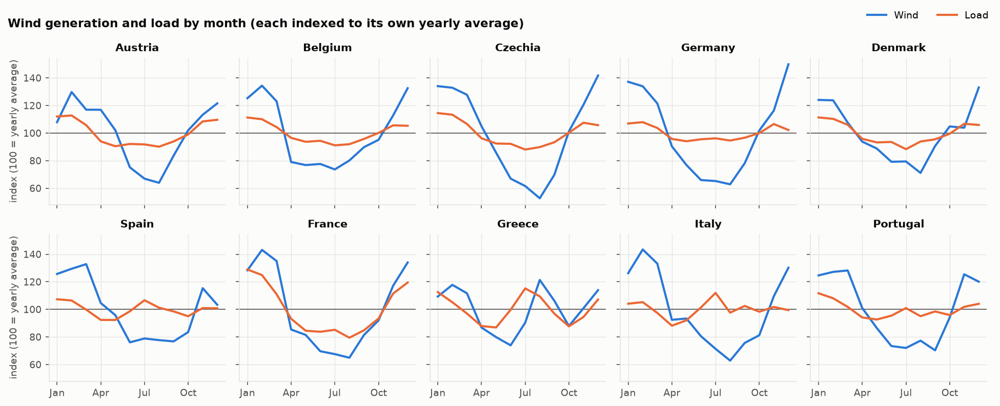
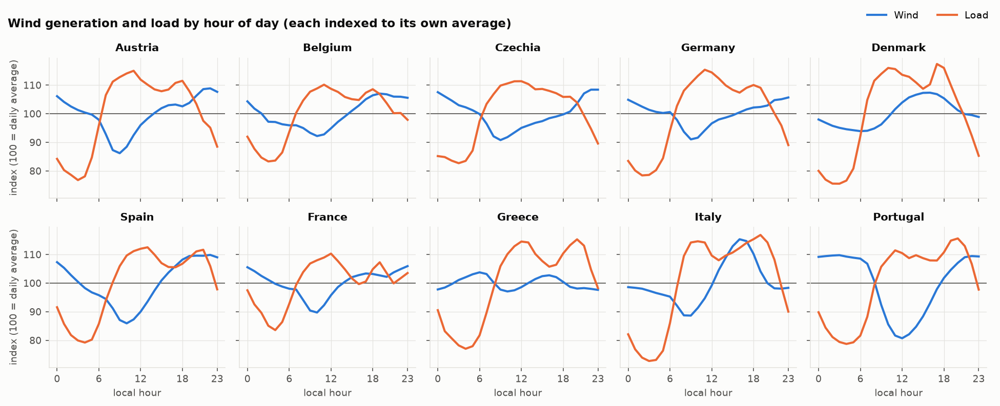
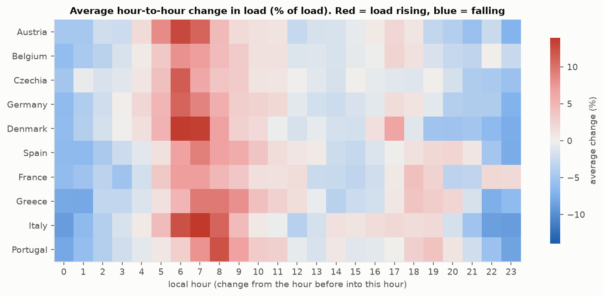
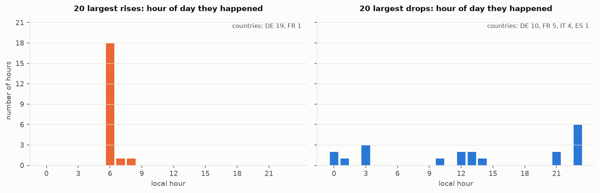
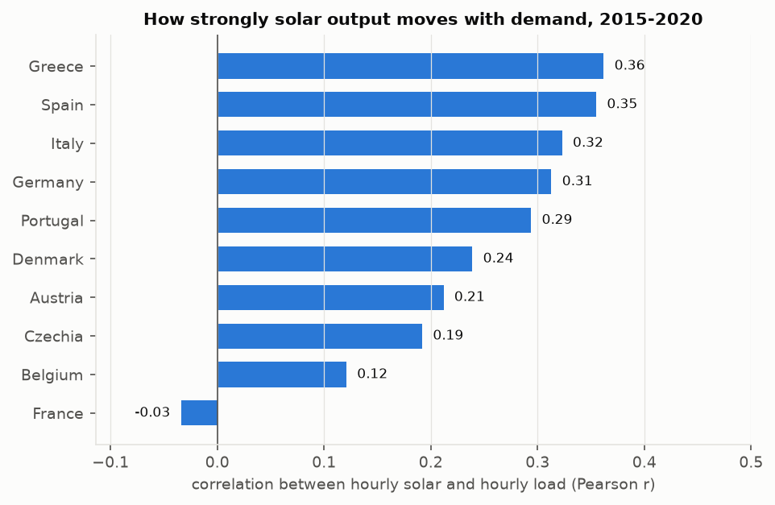
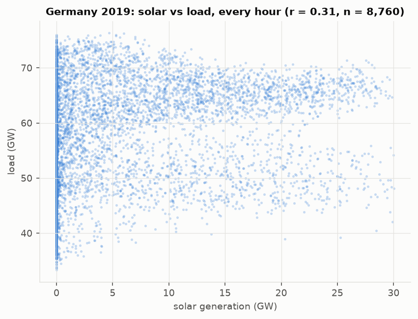

# Findings: answers to the five questions

Owner: Sneh (Sneh913)

Data: 10 countries, January 2015 to September 2020, hourly (Italy from 2016). Every number below comes from our Hive and Pig output in `results/`. Hours are local clock time unless marked UTC. 2020 covers only January to September and includes the spring COVID lockdowns, so it is not a normal full year.

## 1. Which country has the highest renewable share, and how has it changed?

Denmark, in every year. Wind and solar together equalled 43% of Danish load in 2015 and 50% in 2019 (54% in January to September 2020). Almost all of it is wind: in 2019 Denmark averaged 1,819 MW of wind against 111 MW of solar.

The ranking below Denmark is stable at the top and bottom. Germany, Portugal and Spain hold places 2 to 4 every year, and Czechia is last every year at 4 to 5%. France is second to last (6 to 12%), because most French electricity is nuclear, which does not count in our share.

The share went up in every country except Czechia. Between the first year with data and 2019:

| Country | First year | 2019 | Change (points) |
|---|---|---|---|
| Germany | 23.4% (2015) | 33.8% | +10.4 |
| Denmark | 43.4% | 50.4% | +6.9 |
| Austria | 9.6% | 14.8% | +5.1 |
| Belgium | 9.4% | 14.4% | +4.9 |
| Greece | 14.0% | 18.2% | +4.2 |
| Portugal | 24.7% | 28.8% | +4.1 |
| France | 5.7% | 9.4% | +3.8 |
| Spain | 24.4% | 26.7% | +2.3 |
| Italy | 12.3% (2016) | 13.3% | +1.0 |
| Czechia | 4.5% | 4.4% | 0.0 |

Germany grew the most. Its average wind output rose from 8,810 MW in 2015 to 14,133 MW in 2019 while load stayed near 55,000 MW, which moved it from 4th place to 2nd in 2017. In 2020 every country except Portugal rose again, partly because load fell during the lockdowns (German load averaged 53,048 MW, down from 55,990 MW in 2019) and partly because February 2020 was very windy.

The daily view from Pig (chart 6) shows how much the share moves within a year: Denmark's 30-day average swings between about 20% and 75%, Germany's between about 13% and 55%. On single days Danish wind and solar went above 100% of Danish load, up to 131% on 2020-05-16; the extra was exported.

## 2. What does the daily load curve look like in summer and in winter?

In all ten countries load is lowest between 02:00 and 05:00 and climbs steeply from about 06:00. After that, the two seasons look different.

Winter (December to February) has two peaks. One is in the late morning, the other, usually higher, in the early evening when it is dark and people are home: 17:00 in Austria, Czechia and Denmark, 18:00 in Belgium, Germany and Italy, 19:00 in France, Greece and Portugal, 20:00 in Spain. The evening peaks are later in the south and west, following later daily routines.

Summer (June to August) has one broad peak around midday (11:00 to 14:00) and no strong evening peak, because it is light until late.

The size of the gap between summer and winter depends on heating and cooling:

- France uses 34% less electricity in summer than in winter (summer average / winter average = 0.66), the largest gap. Many French homes are heated with electricity, so winter load is high.
- The central and northern countries (AT, BE, CZ, DE, DK) use 10 to 19% less in summer.
- Spain (0.97), Greece (1.00) and Italy (1.01) use about the same in both seasons. Air conditioning raises summer load and makes up for the lower heating. In Greece the summer midday peak (7,394 MW at 13:00) is almost as high as the winter evening peak (7,626 MW at 19:00).

## 3. When does wind generation peak, and does that line up with demand?

By season, wind and demand line up well. In nine of the ten countries wind is strongest between December and March, in all ten it is weakest between June and September, and the windiest month produces 1.6 to 2.7 times as much as the calmest. Load is also highest in winter, so the two move together: the correlation of the 12 monthly averages is 0.87 to 0.96 in Belgium, Czechia, Germany, Denmark and France.

The exceptions are in the south. Greece's wind peaks in August, from the summer meltemi winds over the Aegean, which happens to match its summer air-conditioning peak (load is highest in July). Italy's wind peaks in February while its load peaks in July, so there the monthly correlation is close to zero (0.04).

Within a day, wind and demand mostly do not line up. In most countries wind is weakest in the morning (at 09:00 or 10:00) and strongest in the late evening or at night, while load peaks around midday. The correlation of the 24 hourly averages is negative in seven countries, down to -0.75 in Czechia and -0.59 in Germany and Portugal. The daily wind cycle is small, though: over a day, wind moves about 10 to 20% above and below its average, load 20 to 30%. So the seasonal match matters more.

Denmark and Italy are the two countries where wind does follow the day: both have wind peaking at 16:00, close to their evening load peaks (17:00 and 19:00).

## 4. Which hours show the largest changes in load?

The morning ramp. In every country the largest average rise is into 06:00, 07:00 or 08:00 local time: +13.9% into 07:00 in Italy, +13.6% into 06:00 in Denmark, +12.8% in Austria and +10.9% in Germany. The southern countries start an hour or two later (Greece and Portugal at 08:00).

The largest average drops are late in the evening, into 23:00, midnight or 01:00, between -5.5% (Czechia) and -8.9% (Italy). Load falls more gently in the evening than it rises in the morning.

In absolute terms (MW), the biggest single changes belong to the biggest grid. 19 of the 20 largest rises are German, 18 of them into 06:00, and 16 of the 20 are on a Monday, when industry starts up after the weekend. The largest was +10,957 MW (+20.1%) into 08:00 on 2015-09-22. The 20 largest drops are spread across the day and night, with the largest cluster (6 of 20) into 23:00.

The first version of this answer was wrong. Its top changes were one-hour dips in the Spanish data (load falling by a third and coming back the next hour), and Austrian days at a quarter of normal load. We traced those to errors in the source data and removed them (docs/01-data.md); the results above are after cleaning.

## 5. How strongly is solar generation related to load?

Weakly. Over all hours of 2015 to 2020, the correlation between hourly solar output and hourly load is between 0.12 (Belgium) and 0.36 (Greece) in nine countries, and slightly negative in France (-0.03). The sunnier southern countries (Greece 0.36, Spain 0.35, Italy 0.32) are at the top.

The link is weak because the two follow different cycles. Solar is zero every night and much lower in winter; load is high on winter evenings, when there is no sun at all. France shows this most strongly: its highest loads are on dark, cold winter evenings, so solar and load almost never peak together.

The scatter plot for Germany in 2019 (r = 0.31) shows the structure: a vertical band at 0 GW solar (night hours, any load from 34 to 76 GW), and in daylight two clouds. In sunny hours (above 10 GW solar) the average load is 64.7 GW on weekdays and 50.3 GW at weekends.

Within one season the link is much stronger. In summer alone the correlation is between 0.43 (Italy) and 0.64 (Denmark), because in summer the daily load curve has its peak at midday, at the same time as the sun (question 2).

## Limits of this analysis

- Our renewable share counts only solar and wind. Hydro power is large in Austria (and in Portugal and Spain), so their real share of renewable electricity is higher than shown.
- A share near or above 100% on a day does not mean the country ran only on wind and solar; it can export the surplus and import at other hours.
- Correlation measures only straight-line relationships, and it does not show cause.
- 2020 is nine months long and includes lockdowns. Italy has no 2015.
- We removed 70 readings that were clearly errors (docs/01-data.md). There may be smaller errors left that our rules do not catch.
